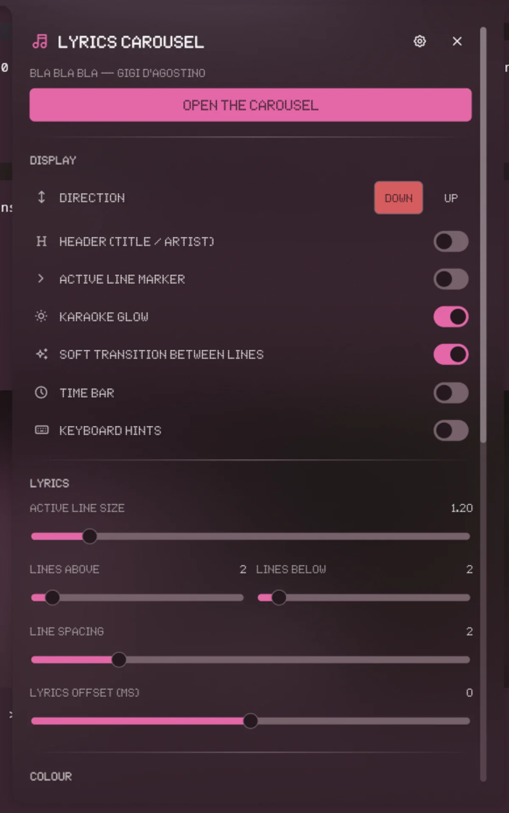

# Noctalia plugins

Plugins for [Noctalia](https://github.com/noctalia-dev/noctalia), the Hyprland shell. Each
plugin lives in its own top-level directory, laid out exactly like the
[community plugin repository](https://github.com/noctalia-dev/community-plugins), so it can be
contributed there with a single pull request.

| Plugin | Id | What it does |
| --- | --- | --- |
| [terminal-widgets](terminal-widgets/) | `faminec/terminal-widgets` | Launches terminal apps in floating windows: one card per command, with a preview of the window and its own size and position. |
| [lyrics-carousel](lyrics-carousel/) | `faminec/lyrics-carousel` | Synced lyrics in a floating terminal window with karaoke and a large active line. |




## Install

Add this repository as a plugin source and enable the plugin:

```sh
noctalia msg plugins source add dev path https://github.com/F4M1N3C/noctalia-plugins
noctalia msg plugins enable faminec/terminal-widgets
noctalia msg plugins enable faminec/lyrics-carousel
```

Then add the **launcher** widget from Noctalia's widget picker, or open the panel directly:

```sh
noctalia msg panel-toggle faminec/terminal-widgets:panel
noctalia msg panel-toggle faminec/lyrics-carousel:panel
```

The [plugin READMEs](terminal-widgets/README.md) and [lyrics-carousel](lyrics-carousel/README.md) are the full documentation: every setting, the
layout format, the IPC commands and how to run the tests.

## Requirements

### Terminal Widgets

- **Noctalia** with plugin API 43 or newer.
- **Hyprland** 0.56 or newer: the plugin uses the Hyprland Lua API to float and place the
  windows, so no `windowrules.lua` change is needed.
- **kitty** (or any other terminal, configurable in the settings).
- **hyprctl** (it comes with the `hyprland` package): it lists, moves, resizes, focuses and
  closes the windows.
- **grim** and **python3** with Pillow, only for the card previews. Without them the cards
  fall back to a static preview and everything else keeps working.

### Lyrics Carousel

- **Hyprland 0.57 or newer only**: the lyrics window is opened with the Hyprland Lua API
  (`hl.dsp.exec_cmd`) and its geometry is applied with `hl.dsp.window.*`. There is no
  Niri or Sway backend.
- **kitty**, **hyprland** / **hyprctl**, **playerctl**, **python3** with Pillow, **fc-match**
  (from `fontconfig`) — see [lyrics-carousel/README.md](lyrics-carousel/README.md).
- The lyrics themselves come from the Noctalia Lyrics plugin's source adapter
  (`lyric_sources.py`), so the same providers and the same configuration are reused:
  LRCLIB, NetEase, SPlayer, QQ Music, Kugou and, with credentials, Spotify, Apple Music
  or Musixmatch.

## Development

The tests live with the plugin and need no desktop:

```sh
lua5.4 terminal-widgets/test-panel.lua          # unit tests
lua5.4 terminal-widgets/test-panel.lua /path/to/another/copy   # run them against another copy
./terminal-widgets/test-smoke.sh                 # live check: open all → rotate → close all

lua5.4 lyrics-carousel/bin/test-panel.lua lyrics-carousel/panel.luau   # panel tests
PYTHONDONTWRITEBYTECODE=1 python3 lyrics-carousel/bin/selftest.py       # full self-test (256 checks)
```

The repository also carries the checks the CI runs:

```sh
./tools/validate-community.sh terminal-widgets   # the official community validator
./tools/validate-community.sh lyrics-carousel
python3 tools/check-locals.py terminal-widgets   # locals used before they are declared
python3 tools/check-luau-globals.py terminal-widgets  # globals read but never written
python3 tools/check-locals.py lyrics-carousel
python3 tools/check-luau-globals.py lyrics-carousel
```

Those two Luau checkers matter because in Luau a `local` only exists from its own declaration
onwards: if a function defined earlier calls it, the reference resolves to a global that is
never assigned and the call fails at runtime with *attempt to call a nil value*.

## License

[MIT](LICENSE)
