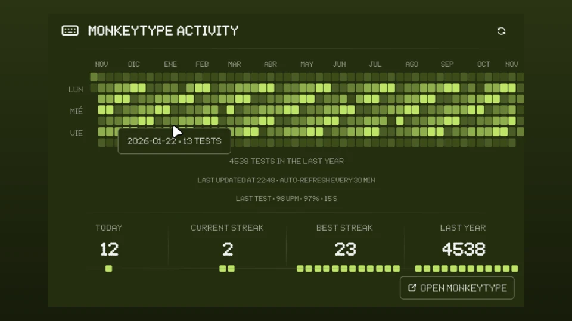

# MonkeyType Activity

A native MonkeyType practice calendar for the Noctalia bar: tests typed today,
your current streak and a hoverable activity heatmap of the last 372 days,
built from the official MonkeyType API instead of scraping the profile page.



## Plugin

| Field | Value |
| --- | --- |
| Plugin ID | `faminec/monkeytype-activity` |
| Entries | Bar widget: `activity`; panel: `calendar`; service: `sync` |
| Minimum Noctalia plugin API | `43` (Noctalia v5.0.0-beta.9 or newer) |

## Requirements

| Requirement | Why |
| --- | --- |
| A MonkeyType **Ape Key** | All per-user endpoints of the API require one. It is free and created on the website. |
| `xdg-open` (`xdg-utils` on Arch) | Opens your MonkeyType profile from the panel. |

Create the key in MonkeyType under **Settings**, then **Ape Keys**, and paste it
into this plugin's settings. The key is read-only for the endpoints this plugin
uses and is sent in an `Authorization` header by the native HTTP client, so it
never appears in a process command line.

## Usage

1. Enable **MonkeyType Activity** in Noctalia's plugin manager and paste your
   Ape Key into its settings.
2. Add the `activity` widget to a bar from the widget picker.
3. Left-click the widget to open the yearly calendar; hover any day to see its
   test count. While no Ape Key is set, a click opens the plugin settings
   instead.
4. Right-click the widget or use the panel's refresh button to refresh now.

The panel can also be opened from the command line:

```bash
noctalia msg panel-toggle faminec/monkeytype-activity:calendar
```

## Settings

| Setting | Options | Default |
| --- | --- | --- |
| Ape Key | text | empty |
| Refresh interval | 10, 15, 30, or 60 minutes | 30 minutes |
| Profile username | text, optional | empty |
| Widget display | Icon and value, or icon only | Icon and value |
| Widget metric | Today's tests, current streak, last WPM, or tests in the last year | Today's tests |
| Show today's tests | On or off | On |
| Show current streak | On or off | On |
| Show best streak | On or off | On |
| Show yearly total | On or off | On |
| Show last test | On or off | On |
| Show profile button | On or off | On |

Widget display and metric belong to each bar-widget instance, so two copies can
show different values. The panel content choices are shared by the calendar
panel. Changing the interval applies it immediately.

The profile username is only used for the button and the panel caption; the Ape
Key already identifies the account.

## Notes

- **No external CLI.** Requests go through Noctalia's native HTTP client; the
  plugin itself never spawns `curl`, `gh` or `jq`.
- **Adaptive polling.** Every tick asks `/users/streak` first. The three heavier
  endpoints (test activity, lifetime stats, last result) only run when a new
  result or a new day can change something, so an idle bar costs one request per
  interval instead of four.
- **Respectful of the API limits.** `/results` is never polled: with an Ape Key
  MonkeyType allows 30 requests per day for it. Manual refreshes are debounced
  and a rate-limit answer (`429`/`479`) backs off for up to an hour.
- **UTC day buckets.** MonkeyType counts daily activity in UTC, so the calendar
  matches the heatmap on monkeytype.com/profile. The streak number comes from
  `/users/streak`, which honours your own streak hour offset.
- **Offline friendly.** The last payload is cached in the plugin data directory
  and rendered before the first request of the session finishes.
- **Privacy.** The only data crossing the network are the requests to
  `api.monkeytype.com`; nothing is sent anywhere else.

## Development

```bash
lua5.4 test-units.lua    # pure modules: dates, levels, API mapping, settings
lua5.4 test-service.lua  # sync service against a mock of the Noctalia runtime
lua5.4 test-widget.lua   # bar widget against a mock of noctalia/barWidget
```
